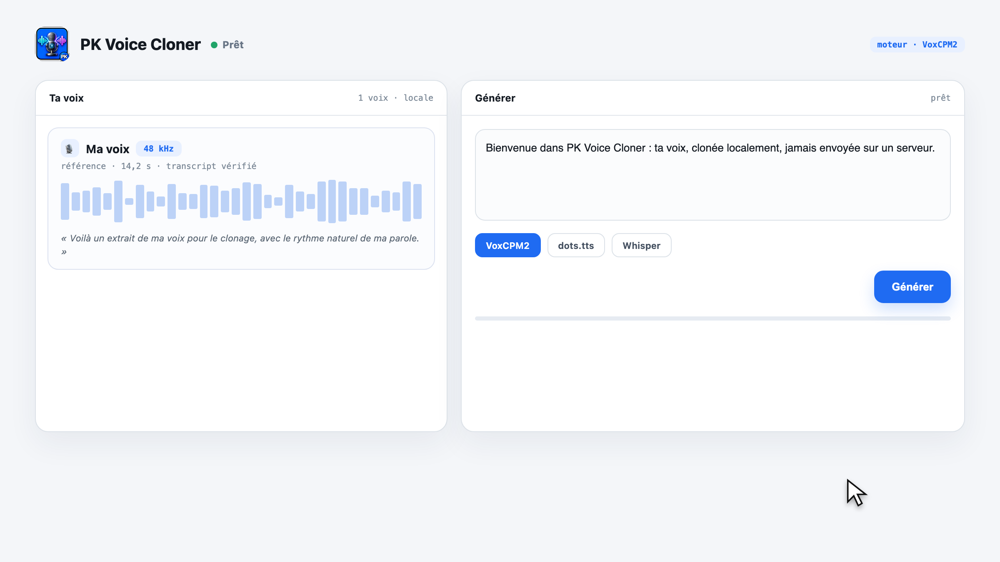
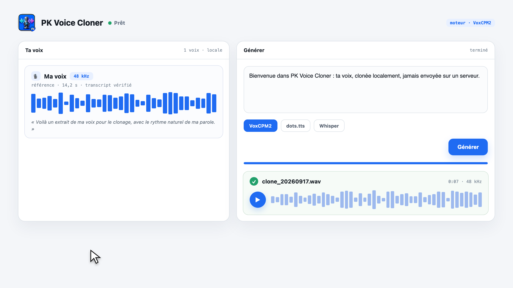
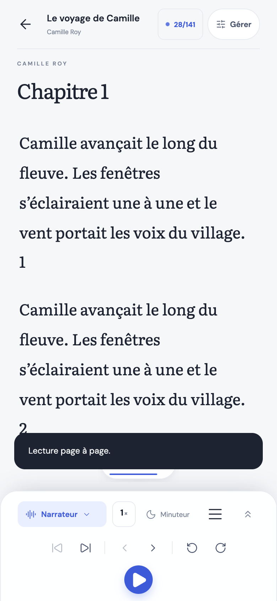
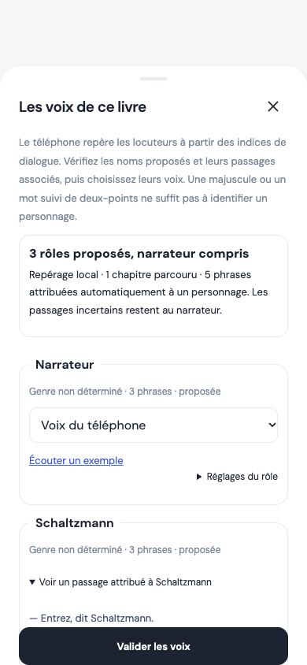

# PK Voice Studio

[🇫🇷 FR](README.md) · [🇬🇧 EN](README_en.md)

version **2026.10.73** · macOS Apple Silicon · Apache-2.0 · [Changelog](CHANGELOG.md)

📱 **Android** — [télécharger l’APK](https://github.com/mondary/Macos_PKvoicecloner/releases/latest/download/PK-Reader-latest.apk) (lien stable qui suit la dernière version) · 🍎 **macOS** — [DMG 2026.10.66](https://github.com/mondary/Macos_PKvoicecloner/releases/tag/v2026.10.66)

🎙️ **Studio vocal IA open source — 100 % local.** Ta voix dit n'importe quel texte. Basé sur [VoxCPM2](https://github.com/OpenBMB/VoxCPM), [dots.tts](https://github.com/studio-dots-ai/dots.tts), [Piper](https://github.com/OHF-Voice/piper1-gpl) et [faster-whisper](https://github.com/SYSTRAN/faster-whisper), sur la puce Apple via MPS. **Aucune donnée ne quitte la machine.**

 

## 📥 Installation

### Android · PK Reader

L’application Android **PK Reader** lit vos EPUB, PDF texte et TXT avec les voix du téléphone, des voix Piper téléchargées ou vos clones PK Voice Studio. Bibliothèque locale, chapitres, signets, thèmes clair/papier/nuit et service audio pour l’écoute en arrière-plan. Lecture **page à page ou en défilement**, barre « en cours » qui garde la phrase lue en vue, changement de voix sans quitter le lecteur et — comme dans le studio — **une voix par personnage** : chaque rôle reçoit sa voix, son pitch et sa vitesse, chaque phrase son personnage — avec l'analyse des personnages par le studio (sexe de la voix, attribution phrase par phrase) et le **karaoké mot à mot** pendant l'écoute. Les voix clonées nécessitent le Mac pour générer les passages ; les chapitres préparés s’écoutent ensuite hors ligne.

**Personnages et voix sur le téléphone** — le repérage local utilise les incises de parole et les échanges nommés. Une majuscule ou un mot suivi de deux-points ne suffit pas à créer un personnage. Dans **Les voix de ce livre**, vérifiez les noms et leurs passages attribués, puis validez les voix proposées. Les passages incertains restent au narrateur : ce repérage par règles ne garantit pas une distribution exhaustive. Les anciennes attributions locales sont réparées à l’ouverture ; corrections manuelles et réglages conservés. Le Mac reste facultatif pour affiner les dialogues avec son provider IA et générer les voix clonées.

**Mise à jour depuis l'app (Android 2026.10.61)** — Réglages → **Mises à jour** : PK Reader vérifie les releases GitHub, télécharge l'APK, contrôle son empreinte et sa signature, puis ouvre l'installateur Android. Plus besoin de passer par le navigateur ni par le dossier Téléchargements. La clé de signature est désormais **permanente** : après une dernière réinstallation pour les versions ≤ 2026.10.60, les mises à jour s'installent par-dessus l'app et conservent la bibliothèque.

[Installation et guide Android](docs/ANDROID.md) · [APK de la version courante](https://github.com/mondary/Macos_PKvoicecloner/releases/tag/pk-2026.10.65) (release `pk-<version>`, lien direct) · [Changelog Android](src/mobile/CHANGELOG.md)

> Les APK vivent dans les releases `pk-<version>` (la plus récente en tête de la page des releases). Le badge **Latest** suit la dernière livraison publiée, Android ou macOS : il peut pointer sur le DMG sans que l'APK disparaisse — le lien direct ci-dessus reste valable.

 



### macOS · PK Voice Studio

Le canal actuellement vérifié est l’installateur depuis les sources (macOS Apple Silicon). Il prépare l’environnement Python et construit l’app :

```sh
curl -fsSL https://raw.githubusercontent.com/mondary/Macos_PKvoicecloner/main/install.sh | sh
```

La release Stable [2026.10.45](https://github.com/mondary/Macos_PKvoicecloner/releases/tag/v2026.10.45) propose un DMG, un installateur macOS et un ZIP signé pour Sparkle. Le cask Homebrew installe le même bundle. Ces paquets nécessitent encore le dépôt source et son environnement Python, préparés par la commande ci-dessus. Voir [la page store](store/website/index.html) et [CHANGELOG](CHANGELOG.md).

Le site publiable prêt pour FTP est autonome dans [`store/website/`](store/website/) : téléverse le contenu de ce dossier sur ton hébergement (le point d’entrée est `index.html`).

## ✅ Fonctionnalités

- **Moteurs commutables** — **VoxCPM2** (MPS, rapide, ~30 langues) et **dots.tts** (2B, clonage haute fidélité 48 kHz, 24 langues) : un clic dans l'en-tête du studio
- **Voix Piper prêtes à l'emploi** — un catalogue de 177 voix (30+ langues) téléchargeables à l'unité (20–80 Mo), avec extrait d'écoute en un clic : narration hors ligne sans clonage, y compris dans les livres où chaque personnage peut mêler clone et voix Piper
- **Modèles à tester** — bouton **Installer** / **Supprimer** pour chaque modèle optionnel (Qwen3-TTS 0,6B, Pocket TTS, Piper) : les poids rejoignent le cache local et **Activer charge réellement le modèle** (moteur TTS en mémoire, transcription préchauffée dans son environnement) avant qu'il devienne sélectionnable comme moteur de génération
- **Clonage ultimate** — clip + transcript → timbre, rythme et style préservés
- **Bibliothèque de voix** — chaque clip importé ou enregistré devient un clone persistant, réutilisable d'une session à l'autre : liste, écoute, sélection, suppression
- **Upload ou micro** — QuickTime `.m4a`, `.mp3`, `.wav`, `.webm`, ou enregistrement direct dans la page (état vide guidé : importer ou s'enregistrer)
- **Transcription auto** — Whisper large-v3 (multilingue) par défaut, ou Parakeet Redux (~178 Mo) en option ; transcript éditable avant génération
- **Gestionnaire de modèles** — choisis dans l'interface les moteurs de synthèse, transcription et catégorisation ; installe puis active le modèle voulu sans passer par le terminal
- **Vitesse** 0,75×–1,5× — étirement temporel pur, le pitch reste intact
- **Lecture au fil de l’eau** — **Lire** à côté de Générer : le texte s’écoute pendant qu’il se synthétise, phrase par phrase. Une voix Piper part instantanément (0,13 s par phrase mesuré) ; une voix clonée démarre dès sa première phrase (~8 s, cache de voix compris) et les suivantes se préparent pendant l’écoute — plus besoin d’attendre la prise entière pour entendre le début
- **Un chapitre se lit en direct** — étape ④ du chapitre : « Lire en direct » lit le chapitre avec la voix de chaque personnage, sans générer un seul segment ; la génération garde son rôle, l’export
- **Mode lecteur** — « Ouvrir le lecteur » : le chapitre en plein écran comme un livre, blocs par personnage, voix de chaque rôle, **karaoké mot à mot**, sauts page et paragraphe, taille de texte et mode focus. La synthèse se fait par fenêtre de 6 phrases, sans bloquer le studio
- **Modèle résident, à la demande** — chargé une fois pendant la session ; **Éteindre** libère sa mémoire dès que tu as fini
- **Offline** — modèles en cache local, aucun appel réseau
- **Versions toujours visibles** — versions de l'app et du serveur affichées dans la barre fixe du haut, à côté de l'état du studio ; un écart est signalé. Le studio web affiche sa version en pied de page
- **Feuille de route** — le plan « double numérique » (clonage rapide, avatar photo → vidéo lipsyncé) se lit dans [TODO.md](TODO.md)
- **`mavox`** — clone en une commande depuis le terminal, texte quoté ou non
- **App native macOS** — interface native SwiftUI, zéro navigateur : le serveur démarre et s'arrête avec l'app, mises à jour automatiques via Sparkle
- **Vue d’ensemble sans doublons** — stats des voix, modèles, livres et confidentialité ; état du serveur, activation rapide d’une voix et installation de modèle, avec une couleur par action : installer, activer, désactiver
- **Studio livre intégré à l'app native** — bouton « Ouvrir le studio web » : ouvre la bibliothèque EPUB et son éditeur dans une fenêtre de l'app macOS (WKWebView), pendant que le serveur local tourne
- **Réglages dans la fenêtre principale (⌘,)** — providers IA et clés API, token Hugging Face, Crédits & inspirations, Bibliothèque de projets, Soutenir/Ko-fi et À propos avec canaux Stable/Dev. L’icône waveform de la barre des menus rouvre le studio ; Dock et menu bar se règlent séparément dans Général.
- **Navigation alignée app / studio web** — mêmes entrées des deux côtés : Vue d'ensemble, Bibliothèque de voix, Texte vers voix, Livres, Modèles, Réglages ; l'app ouvre le studio des livres directement sur le livre choisi
- **Livres audio (studio web)** — importe un EPUB, compare l'original au texte structuré phrase par phrase, avec attribution colorée des voix, génération des segments et écoute continue avec respirations selon la ponctuation ; l'éditeur audiobook n'est pas encore intégré à SwiftUI
- **Lecture fidèle du français** — avant la synthèse, le texte est développé : « M. » → « Monsieur », « Louis XVI » → « Louis seize », « 1789 » en toutes lettres, pourcentages, euros et degrés ; le texte affiché reste celui de l'auteur
- **Redécouper phrase par phrase** — un chapitre analysé par paragraphes se rescinde en phrases complètes, coupées aux clauses si trop longues, sans nouvelle analyse IA ; les audios du chapitre sont alors régénérés au bon rythme
- **Tout automatiser** — un clic sur un chapitre ou sur le livre enchaîne analyse IA si besoin → découpe phrase par phrase → attribution automatique des voix selon le genre des personnages (féminine/masculine, narrateur d'abord) ; tes associations manuelles sont conservées et la fin de séquence t'indique ce qui a été attribué
- **Analyse et voix des livres** — enregistre plusieurs providers OpenAI-compatibles (GLM, DeepSeek, OpenAI ou Ollama local), associe chaque personnage à une voix de la bibliothèque et génère les segments **par échantillon de 20 lignes, par chapitre entier ou individuellement** ; chaque chapitre suit une séquence numérotée — attribution → découpe en phrases → génération → écoute → export ; la page livre affiche l'état des analyses, segments et audios
- **Contrôle d'attribution local (Laya)** — un petit modèle embarqué (322M, chargé une fois depuis le cache Hugging Face partagé) relit chaque chapitre et signale les segments « narrateur » qui ressemblent à du dialogue : zéro token, zéro cloud après le premier téléchargement
- **Export audiobook** — « Exporter le chapitre » produit un WAV unique avec les pauses de ponctuation intégrées ; « Exporter l'audiobook » assemble le livre en **M4B chapitré** (pochette, métadonnées), écoutable dans Apple Livres et la plupart des lecteurs
- **Studio épuré** — tableau de bord monochrome : bibliothèque de voix, éditeur et catalogue de modèles

### Interface native

- **Démarrer** lance le serveur local, y compris depuis Finder. L'état du modèle s'actualise automatiquement.
- **Démarrage automatique** : le serveur démarre à l'ouverture de l'app ; éteint, un panneau d'accueil explique et propose un gros bouton Démarrer.
- **Installation puis activation enchaînées** : un modèle installé depuis le studio s'active tout seul à la fin du téléchargement.
- **Bibliothèque de voix** : importer un audio, enregistrer au micro, sélectionner une voix, l’écouter ; menu **…** pour renommer ou supprimer.
- **Modèles** : installer un moteur du catalogue pris en charge, l’activer ; menu **…** pour renommer ou supprimer ses poids locaux. Les installations et erreurs sont visibles.
- **Texte vers voix** : éditer le transcript, régler la vitesse, générer, puis écouter ou exporter le WAV.
- **Ouvrir le studio web** : c'est **l'action principale de l'app** — un grand bouton en tête de la Vue d'ensemble, doublé d'un raccourci dans la barre fixe du haut ; il ouvre l'atelier complet (voix, texte, livres, modèles) dans une fenêtre du studio. Le serveur doit être démarré.
- Les erreurs apparaissent dans la page avec un accès au journal du serveur.

## 🧠 Utilisation

1. Ouvre **PK Voice Cloner.app** depuis le dossier macOS **Applications** (chemin : `/Applications/PK Voice Cloner.app`)
2. À gauche : **Importer** un clip ou **Enregistrer** ta voix → la transcription part toute seule et le clone rejoint la bibliothèque
3. Sélectionne une voix, écris ton texte à droite, règle la vitesse si besoin, **Générer**
4. Écoute, télécharge, recommence — les clones restent disponibles au prochain lancement
5. Quand la session est terminée, clique **Éteindre** en haut à droite : le serveur Python et VoxCPM sont arrêtés et leur mémoire est libérée.

### Terminal

```sh
./scripts/ma-voix.sh Le texte que ta voix doit dire
./scripts/ma-voix.sh -a ~/Desktop/nouvel_enregistrement.m4a Le texte

# Si le navigateur est déjà fermé : arrêt sûr du studio et de son modèle
./scripts/arreter-studio.sh
```

## ⚙️ Prérequis

- macOS Apple Silicon, 16 Go de RAM minimum (32 Go recommandé)
- `brew install ffmpeg`
- Les modèles (~5 Go VoxCPM2 + ~3 Go Whisper) se téléchargent au premier lancement, puis tout est local
- App non notarisée : au premier lancement depuis un DMG, clic droit → **Ouvrir** (une seule fois)

## 📦 Build & Run

```sh
# En une commande
curl -fsSL https://raw.githubusercontent.com/mondary/Macos_PKvoicecloner/main/install.sh | sh

# À la main
brew install ffmpeg
uv venv .venv && uv venv .venv-whisper
uv pip install --python .venv/bin/python -e vendor/VoxCPM
uv pip install --python .venv-whisper/bin/python faster-whisper 'moondream>=2.4.1'
# moteur dots.tts (optionnel) — pynini ne compile pas sur macOS, on l'installe sans
uv pip install --python .venv/bin/python --no-deps dots-tts
# moteur Piper (optionnel) — voix prêtes à l'emploi, téléchargées ensuite dans le studio
uv pip install --python .venv/bin/python piper-tts
uv pip install --python .venv/bin/python huggingface-hub loguru "langcodes[data]" einops "librosa>=0.11.0" "torchaudio>=2.8" torchdiffeq tqdm lingua-language-detector

# Lancer le serveur seul
./.venv/bin/python src/server/serveur.py

# Ou construire l'app native (fenêtre intégrée, pas de navigateur) puis la lancer
./scripts/build.sh
open "releases/PK Voice Cloner.app"
```

## 🗂️ Structure

| Chemin | Rôle |
|---|---|
| `src/server/` | Serveur FastAPI |
| `TODO.md` | Feuille de route du double numérique : voix, avatar, lipsync |
| `src/web/` | Studio web (`page.html`, `assets/`) |
| `src/macos/PKVoiceCloner.swift` | App native macOS : interface SwiftUI et cycle de vie de l’app |
| `src/macos/Studio.swift` | Client HTTP natif, démarrage Python, import, micro et lecture audio |
| `scripts/build.sh` | Build de l'app (`swiftc` + Sparkle embarqué + icône) |
| `scripts/ma-voix.sh` | Clonage en ligne de commande |
| `scripts/arreter-studio.sh` | Arrêt sûr du serveur local et libération du modèle |
| `data/voix`, `data/sorties` | Bibliothèque de clones (références + transcripts) et audios générés (privé, non versionné) |
| `vendor/VoxCPM` | Modèle et bibliothèque (Apache-2.0) |
| `.venv`, `.venv-whisper` | Environnements Python (non versionnés) |
| `src/web/assets/` | Logique d'interface (`studio.js`) et licence MIT du runtime Three.js historique |

## ⚠️ Éthique

Le clonage de voix est interdit pour l'usurpation d'identité. Ce projet est conçu pour ta propre voix : un produit public devrait exiger une preuve de consentement.

## 🔗 Crédits — outils et modèles utilisés

- [VoxCPM / VoxCPM2](https://github.com/OpenBMB/VoxCPM) — OpenBMB, Apache-2.0
- [dots.tts](https://github.com/studio-dots-ai/dots.tts) — dots studio, Apache-2.0
- [faster-whisper](https://github.com/SYSTRAN/faster-whisper) — SYSTRAN
- [Parakeet Redux](https://huggingface.co/moondream/parakeet-redux) — Moondream, poids CC-BY-4.0, runtime Photon
- [Photon](https://moondream.ai/photon) — moteur d'inférence local Moondream
- [Qwen3-TTS](https://github.com/QwenLM/Qwen3-TTS) — moteur TTS optionnel
- [Pocket TTS](https://github.com/kyutai-labs/pocket-tts) — moteur TTS optionnel de Kyutai
- [Piper](https://github.com/OHF-Voice/piper1-gpl) et [piper-voices](https://huggingface.co/rhasspy/piper-voices) — moteur TTS léger et voix prêtes à l'emploi
- [Laya](https://huggingface.co/convaiinnovations) — catégorisation locale des voix et personnages
- [Sparkle](https://github.com/sparkle-project/Sparkle) — mises à jour de l'app macOS
- [Three.js](https://threejs.org/) — runtime 3D MIT historique (v0.3), distribué localement

### Inspirations

- [ThreeUI Community](https://github.com/MengTo/threeui) — source du runtime Three.js et inspiration des composants, MIT
- [ElevenLabs](https://elevenlabs.io/) — inspiration pour l’interface du studio vocal

---

🇬🇧 See [README_en.md](README_en.md) for English version.

❤️ Soutenir ce projet sur [Ko-fi](https://ko-fi.com/pouark).
