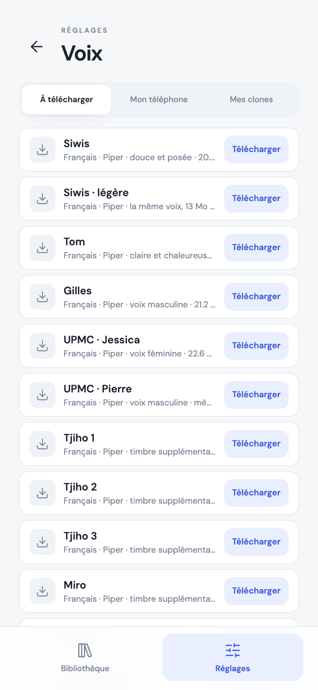
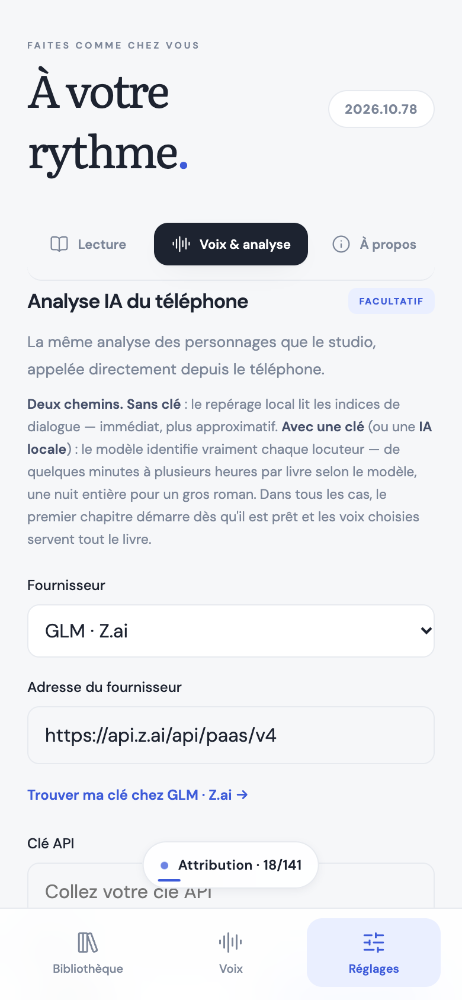
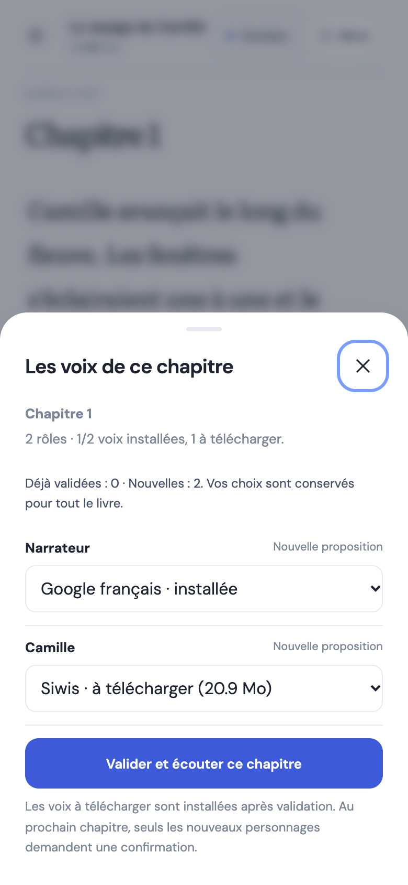

# PK Voice Studio

[🇫🇷 FR](README.md) · [🇬🇧 EN](README_en.md)

version **2026.10.95** · macOS Apple Silicon · Apache-2.0 · [Changelog](CHANGELOG.md)

📱 **Android** — [download the APK](https://github.com/mondary/Macos_PKvoicecloner/releases/latest/download/PK-Reader-latest.apk) (stable link following the latest version) · 🍎 **macOS** — [DMG 2026.10.66](https://github.com/mondary/Macos_PKvoicecloner/releases/tag/v2026.10.66)

🎙️ **Open source AI voice studio — 100 % local.** Your voice says any text. Powered by [VoxCPM2](https://github.com/OpenBMB/VoxCPM), [dots.tts](https://github.com/studio-dots-ai/dots.tts), [Piper](https://github.com/OHF-Voice/piper1-gpl) and [faster-whisper](https://github.com/SYSTRAN/faster-whisper) on Apple Silicon via MPS. **No data ever leaves the machine.**

 

## 📥 Installation

### Android · PK Reader

The **PK Reader** Android app reads EPUB, text PDFs and TXT using Android voices, downloaded Piper voices — **eleven French voices**, one of them only 13 MB and **Siwis · Kokoro** (132 MB), the most natural one — or your PK Voice Studio clones. Local library, chapters, bookmarks, light/paper/night themes and a native audio service for background listening. Turn pages or keep a continuous scroll, a bottom bar keeps the sentence being read in view, voices can be changed without leaving the reader, and — like in the studio — **one voice per character**: each role gets its own voice, pitch and speed, each sentence its speaker, with **word-by-word karaoke** while listening. The **“Prepare and listen”** button analyses the chapter you are about to hear first, then **starts playback** while the rest of the book keeps being analysed in the background; the audio queue refreshes at chapter changes, and per-chapter offline caching remains available. Cloned voices require the Mac to generate new passages; prepared chapters can then be played offline.

**Characters and voices, no Mac** — two self-contained modes on the phone. **With the phone AI** (Settings → Phone AI analysis: URL, model, API key — or a **local AI** such as Ollama/LM Studio/llama.cpp, no key needed), the model identifies speaking characters, assigns each sentence and then reviews the uncertain passages — the same quality as the studio, without a gateway. **Without configuration**, local detection relies on attribution clauses and corroborated labels and leaves anything ambiguous to the narrator. In both cases, review the name and **See an assigned passage**, then confirm the voices. The AI key stays encrypted on the phone (Android Keystore); analysed text is sent to the chosen provider. Cloned voices are still generated by the Mac — that is the cloning engine — but analysis, casting and Piper/Android playback are self-contained.

**In-app updates (Android 2026.10.61)** — Settings → **Updates**: PK Reader checks GitHub releases, downloads the APK, verifies its digest and signature, then opens the Android installer. No more browser or Downloads folder. The signing key is now **permanent**: after one last reinstall for versions ≤ 2026.10.60, updates install over the app and keep the library.

**Analysis progress** — a discreet pill at the bottom of the screen (a chip inside the reader) shows the current step and saved batches, with elapsed time and a remaining estimate. Tap it for details and voices; results fade on their own, errors stay until dismissed.

**Manage the book** — four steps (Paragraphs, Analysis, Voices, Current-chapter listening) show their percentage and details, and can be relaunched separately; “Relaunch everything” chains paragraphs, full analysis, voices and playback.

**Grouped controls** — chapter, page and sentence navigation sit near Play/Pause, with distinct labels. The analysis count stays beside “Manage”. Voice downloads remain visible in a fixed notification until the result is dismissed. About provides an explicit “Support on Ko-fi” button. Navigation keeps only **Library** and **Settings**; the compact voice list opens from Settings → Voices & analysis.

**Confirm a chapter, not the whole book** — before playback, a summary proposes voices for this chapter’s characters, distinguishing installed voices from downloads. It opens **even during analysis**: choose, confirm, and playback starts right away with that provisional casting, which analysis then refines. Those choices carry over to later chapters; only new characters ask for confirmation again. If everything is already confirmed, playback continues without a dialog.

**Choose by listening** — every proposal has a preview button playing an excerpt in the actually selected, named voice. While reading, the player collapses by default so **several paragraphs fit on a page**; a chevron expands all controls, and a button toggles paged / continuous scrolling without leaving the book.

**Room for books** — visible search, large covers and a compact resume strip. Sentences flow into real paragraphs in the reader, with navigation arranged around Play/Pause on one line. The blue identity, discovery guide and voice choices are unchanged.

[Android installation and guide (French)](docs/ANDROID.md) · [Current APK](https://github.com/mondary/Macos_PKvoicecloner/releases/tag/pk-2026.10.87) (`pk-<version>` release, direct link) · [Android changelog](src/mobile/CHANGELOG.md)

> APKs live in `pk-<version>` releases (newest first on the releases page). The **Latest** badge follows the last published release, Android or macOS: it may point at the DMG without the APK disappearing — the direct link above stays valid.

  






### macOS · PK Voice Studio

The currently verified channel is the source installer (macOS Apple Silicon). It prepares the Python environment and builds the app:

```sh
curl -fsSL https://raw.githubusercontent.com/mondary/Macos_PKvoicecloner/main/install.sh | sh
```

Stable release [2026.10.45](https://github.com/mondary/Macos_PKvoicecloner/releases/tag/v2026.10.45) provides a DMG, a macOS installer and a signed Sparkle ZIP. The Homebrew cask installs the same bundle. These packages still require the source checkout and its Python environment, prepared by the command above. See the [store page](store/website/index.html) and [CHANGELOG](CHANGELOG.md).

The FTP-ready website is self-contained in [`store/website/`](store/website/): upload the contents of this folder to your hosting (entry point: `index.html`).

## ✅ Features

- **Switchable engines** — **VoxCPM2** (MPS, fast, ~30 languages) and **dots.tts** (2B, high-fidelity 48 kHz cloning, 24 languages): one click in the studio header
- **Ready-made Piper voices** — a catalogue of 177 voices (30+ languages) downloaded one at a time (20–80 MB), with a one-click listening preview: offline narration without cloning, including inside books where each character can mix a clone and a Piper voice
- **Models to try** — an **Install** / **Delete** button per optional model (Qwen3-TTS 0.6B, Pocket TTS, Piper): weights land in the local cache and **Activate really loads the model** (TTS engine into memory, transcription pre-warmed in its own environment) before it becomes selectable as a generation engine
- **Ultimate cloning** — clip + transcript → timbre, rhythm and style preserved
- **Voice library** — every imported or recorded clip becomes a persistent clone, reusable across sessions: list, preview, select, delete
- **Upload or mic** — QuickTime `.m4a`, `.mp3`, `.wav`, `.webm`, or record straight in the page (guided empty state: import or record)
- **Auto transcription** — Whisper large-v3 (multilingual) by default, or Parakeet Redux (~178 MB) as an option; edit the transcript before generating
- **Model manager** — choose TTS, transcription and categorization engines in the UI; install and activate the model you want without using the terminal
- **Speed** 0.75×–1.5× — pure time-stretch, pitch stays untouched
- **Live reading** — **Lire** next to Generate: the text plays while it is synthesised, sentence by sentence. A Piper voice starts instantly (0.13 s per sentence measured); a cloned voice starts at its first sentence (~8 s, voice cache included) and the rest is prepared during playback — no more waiting for the whole take to hear the beginning
- **A chapter reads live** — step ④ of a chapter: “Lire en direct” reads it with each character’s voice, without generating a single segment; generation keeps its role, export
- **Reader mode** — “Ouvrir le lecteur”: the chapter full screen like a book, blocks per character, each role’s voice, **word-by-word karaoke**, page and paragraph jumps, text size and focus mode. Synthesis runs in 6-sentence windows so the studio never stalls
- **On-demand resident model** — loaded once for a session; **Power off** releases its memory when you are done
- **Offline** — models cached locally, no network calls
- **Always-visible versions** — app and server versions appear in the sticky top bar beside studio status, with a mismatch warning; the web studio version remains in its footer
- **Roadmap** — the "digital double" plan (fast voice cloning, photo → lipsynced video avatar) lives in [TODO.md](TODO.md)
- **`mavox`** — one-command cloning from the terminal, quoted or not
- **Native macOS app** — SwiftUI interface: the server starts and stops with the app, automatic Sparkle updates
- **No-duplicate overview** — voice, model, book and privacy stats; server health, quick voice selection and model installation, with one colour per action: install, activate, deactivate
- **Book studio inside the native app** — “Open web studio” opens the EPUB library and editor in a macOS app window (WKWebView) while the local server is running
- **Settings inside the main window (⌘,)** — AI providers and API keys, Hugging Face token, dedicated Credits & inspirations, Project Library, Support/Ko-fi, and About with Stable/Dev channels. The waveform menu bar icon reopens the studio; Dock and menu bar visibility can be configured separately in General.
- **Aligned navigation, app / web studio** — the same entries on both sides: Overview, Voice library, Text to voice, Books, Models, Settings; the app opens the book studio directly on the chosen book
- **Audiobooks (web studio)** — import an EPUB and compare its preserved original with the AI-structured text sentence by sentence, with color-coded voice assignments, segment generation, and continuous playback with punctuation-based breathing pauses; the audiobook editor is not yet part of SwiftUI
- **Faithful French reading** — before synthesis the text is expanded: “M.” → “Monsieur”, “Louis XVI” → “Louis seize”, “1789” spelled out, percentages, euros and degrees; the text shown in the studio stays the author's
- **Re-split sentence by sentence** — a chapter analysed by paragraphs is re-cut into full sentences, split at clause boundaries when too long, without a new AI pass; the chapter audio is then regenerated at the right rhythm
- **Automate everything** — one click on a chapter or on the whole book chains AI analysis when needed → sentence-by-sentence re-split → automatic voice assignment by character gender (feminine/masculine, narrator first); your manual assignments are kept and the end of the run reports what was assigned
- **Book analysis and voices** — save multiple OpenAI-compatible providers (GLM, DeepSeek, OpenAI or local Ollama), map each character to a library voice, and generate segments **as a 20-line sample, a whole chapter, or one by one**; every chapter follows a numbered sequence — attribution → sentence splitting → generation → listening → export; the book page tracks analysis, segments and generated audio
- **Local attribution check (Laya)** — a small on-device model (322M, loaded once from the shared Hugging Face cache) reviews each chapter and flags “narrator” segments that look like dialogue: zero tokens, zero cloud after the first download
- **Audiobook export** — “Export chapter” produces a single WAV with punctuation pauses baked in; “Export audiobook” assembles the book into a **chaptered M4B** (cover, metadata) that plays in Apple Books and most players
- **Automatic startup** — the server starts when the app opens; when off, a welcome panel explains it with a big Start button
- **Install then activate in one go** — a model installed from the studio activates by itself once the download finishes
- **Clean studio** — an ElevenLabs-style clear interface: voices on the left, text and **Generate** on the right, PK coral accent

## 🧠 Usage

1. Open **PK Voice Cloner.app** from the macOS **Applications** folder (path: `/Applications/PK Voice Cloner.app`)
2. On the left: **Import** a clip or **Record** your voice → transcription runs on its own and the clone joins the library
3. Select a voice, type your text on the right, set the speed if needed, **Generate**
4. Listen, download, repeat — clones stay available on next launch
5. At the end of a session, click **Power off** at the top right: the Python server and VoxCPM stop and release their memory.
6. Click **Open web studio** — the app's main action, a large button at the top of the overview with a shortcut in the sticky top bar. It opens the full workshop (voices, text, books, models) in a studio window; the server must be running.

### Terminal

```sh
./scripts/ma-voix.sh The text your voice should say
./scripts/ma-voix.sh -a ~/Desktop/new_recording.m4a The text

# If the browser is already closed: safely stop the studio and its model
./scripts/arreter-studio.sh
```

## ⚙️ Requirements

- macOS Apple Silicon, 16 GB RAM minimum (32 GB recommended)
- `brew install ffmpeg`
- Models (~5 GB VoxCPM2 + ~3 GB Whisper) download on first launch, then everything is local
- App is not notarized: on first launch from a DMG, right-click → **Open** (once)

## 📦 Build & Run

```sh
# One command
curl -fsSL https://raw.githubusercontent.com/mondary/Macos_PKvoicecloner/main/install.sh | sh

# By hand
brew install ffmpeg
uv venv .venv && uv venv .venv-whisper
uv pip install --python .venv/bin/python -e vendor/VoxCPM
uv pip install --python .venv-whisper/bin/python faster-whisper 'moondream>=2.4.1'
# dots.tts engine (optional) — pynini does not build on macOS, install without it
uv pip install --python .venv/bin/python --no-deps dots-tts
# Piper engine (optional) — ready-made voices, downloaded later from the studio
uv pip install --python .venv/bin/python piper-tts
uv pip install --python .venv/bin/python huggingface-hub loguru "langcodes[data]" einops "librosa>=0.11.0" "torchaudio>=2.8" torchdiffeq tqdm lingua-language-detector

# Run the server only
./.venv/bin/python src/server/serveur.py

# Or build the native app (embedded window, no browser) and launch it
./scripts/build.sh
open "releases/PK Voice Cloner.app"
```

## 🗂️ Layout

| Path | Role |
|---|---|
| `src/server/` | FastAPI server |
| `TODO.md` | Digital-double roadmap: voice, avatar, lipsync |
| `src/web/` | Web studio (`page.html`, `assets/`) |
| `src/macos/PKVoiceCloner.swift` | Native macOS app: WKWebView window, Python server lifecycle, Sparkle |
| `scripts/build.sh` | App build (`swiftc` + bundled Sparkle + icon) |
| `scripts/ma-voix.sh` | Command-line cloning |
| `scripts/arreter-studio.sh` | Safely stops the local server and releases the model |
| `data/voix`, `data/sorties` | Clone library (references + transcripts) and generated audio (private, not versioned) |
| `vendor/VoxCPM` | Model and library (Apache-2.0) |
| `.venv`, `.venv-whisper` | Python environments (not versioned) |
| `src/web/assets/` | UI logic (`studio.js`) and the legacy MIT Three.js license notice |

## ⚠️ Ethics

Voice cloning must not be used for impersonation. This project is meant for your own voice; a public product should require proof of consent.

## 🔗 Credits — tools and models used

- [VoxCPM / VoxCPM2](https://github.com/OpenBMB/VoxCPM) — OpenBMB, Apache-2.0
- [dots.tts](https://github.com/studio-dots-ai/dots.tts) — dots studio, Apache-2.0
- [faster-whisper](https://github.com/SYSTRAN/faster-whisper) — SYSTRAN
- [Parakeet Redux](https://huggingface.co/moondream/parakeet-redux) — Moondream, CC-BY-4.0 weights, Photon runtime
- [Photon](https://moondream.ai/photon) — Moondream local inference engine
- [Qwen3-TTS](https://github.com/QwenLM/Qwen3-TTS) — optional TTS engine
- [Pocket TTS](https://github.com/kyutai-labs/pocket-tts) — optional TTS engine by Kyutai
- [Piper](https://github.com/OHF-Voice/piper1-gpl) and [piper-voices](https://huggingface.co/rhasspy/piper-voices) — lightweight TTS engine and ready-made voices
- [Laya](https://huggingface.co/convaiinnovations) — local voice and character categorization
- [Sparkle](https://github.com/sparkle-project/Sparkle) — macOS app updates
- [Three.js](https://threejs.org/) — legacy MIT 3D runtime (v0.3), locally distributed

### Inspirations

- [ThreeUI Community](https://github.com/MengTo/threeui) — Three.js runtime source and component inspiration, MIT
- [ElevenLabs](https://elevenlabs.io/) — voice-studio interface inspiration

---

🇫🇷 Voir [README.md](README.md) pour la version française.

❤️ Support this project on [Ko-fi](https://ko-fi.com/pouark).
